  

  

  
  
  

---

## 👋 About me

I'm a data engineer who loves making messy data fast, clean and useful.
I've built pipelines at Amazon, Providence and Dell, and I'm now finishing my MS in Data Science at Columbia.

- 🎓 **MS in Data Science** at Columbia University (GPA 3.6)
- 💼 **Data Engineer Intern** at Amazon, Summer 2026
- 🏥 3+ years building data platforms for healthcare and sales teams
- 🤖 Currently exploring AI agents, MCP servers and text-to-SQL
- 💬 Ask me about Airflow, Snowflake, dbt or why data quality matters

---

  

---|---|---|
| 💼 | **Dell Technologies** · BI & Data Engineer | Ran 80+ daily Airflow jobs and cut manual runbook work by 75% |
| 🏥 | **Providence Global Center** · Senior Data Engineer | Took TB-scale data refreshes from 8 hours down to 30 minutes |
| 🎓 | **Columbia University** · MS Data Science | Studying applied deep learning, GenAI and agentic AI |
| 📦 | **Amazon** · Data Engineer Intern | Built an MCP server that cut manual engineering effort by 40% |
| 🚀 | **What's next?** | Maybe your team 😊 |

---

## 🚀 Featured projects

<table>
<tr>
<td width="50%" valign="top">

### 🧾 [QuoteFlow](https://github.com/Shweta-3001/QuoteFlow-AI-Native-B2B-Procurement-Platform)
An AI procurement platform where four agents help buyers write RFQs, compare suppliers and pick a winner.

[**▶ Try it live**](https://quoteflow-buyer-727209058163.us-central1.run.app)

`Google ADK` `Gemini` `FastAPI` `Cloud Run`

</td>
<td width="50%" valign="top">

### 🌍 [Migration Intelligence Agent](https://github.com/Shweta-3001/Migration-Intelligence-Agent)
Ask which countries are best to move to and it pulls live data from 6 APIs, runs the analysis and explains the answer.

[**▶ Try it live**](https://migration-intelligence-agent-1008110254578.us-central1.run.app/)

`Multi-agent` `Gemini` `DuckDB` `Plotly`

</td>
</tr>
<tr>
<td width="50%" valign="top">

### 📦 [Forecast Assistant](https://github.com/Shweta-3001/Forecast-Assistant)
A chat-style tool that forecasts sales for any product or customer. Just ask "forecast product 85123A for 4 weeks".

`FastAPI` `Time series` `Clustering` `Docker`

</td>
<td width="50%" valign="top">

### 💬 [Agentic SQL Assistant](https://github.com/Shweta-3001/Online_Reatil-Agentic-SQL-Assistant)
Ask a business question in plain English and the agent writes safe SQL, runs it and explains the result.

`Gemini` `MySQL` `n8n` `Docker`

</td>
</tr>
<tr>
<td colspan="2" valign="top">

### 🥗 [MacroCart](https://github.com/Shweta-3001/Macrocart_nutrition-assistant)
Builds a full week of meals that hit your daily macros and budget, powered by a local LLM.

`FastAPI` `Ollama` `Python`

</td>
</tr>
</table>

### 🧩 More things I've built

- 🧠 [**Brain Tumour Detection**](https://github.com/Shweta-3001/Brain-Tumour-Detection-Using-YOLOv10) spots tumors in MRI scans with 0.96 mAP@50.
- ⚡ [**Energy Demand Forecasting**](https://github.com/Shweta-3001/Time-Series-Forecasting) predicts a power grid's hourly demand a full year ahead.
- 📈 [**Stock Price Forecasting**](https://github.com/Shweta-3001/Time-Series-Forecasting-using-LSTM-for-stock-exchange) predicts Microsoft's next closing price with an LSTM.

---

## 🛠️ Toolbox

  

  
  
  
  
  
  
  
  
  
  
  
  
  

---

## 💡 Fun facts

- ⏱️ My favorite win was turning an 8 hour data refresh into a 30 minute one
- 🤖 Two of my AI agent projects are live on the web right now. Click and try them.
- ⚡ The power grid uses the least electricity around 4 AM. My forecasting model figured that out on its own.

---

  <i>Always happy to chat about data pipelines, AI agents or a really good dataset.</i> 
  <a href="https://www.linkedin.com/in/shweta-smriti-tripathi/"><b>Let's connect on LinkedIn</b></a>

  

